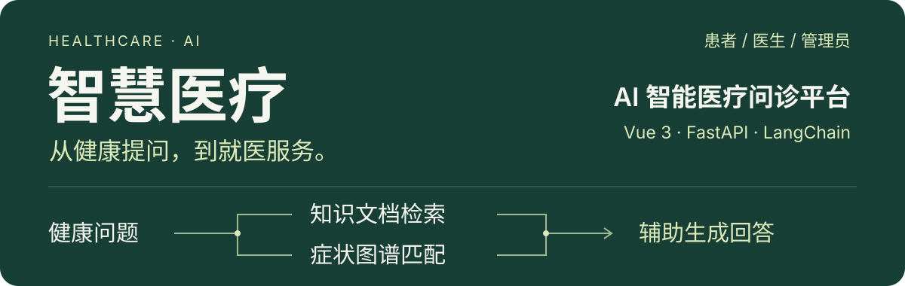
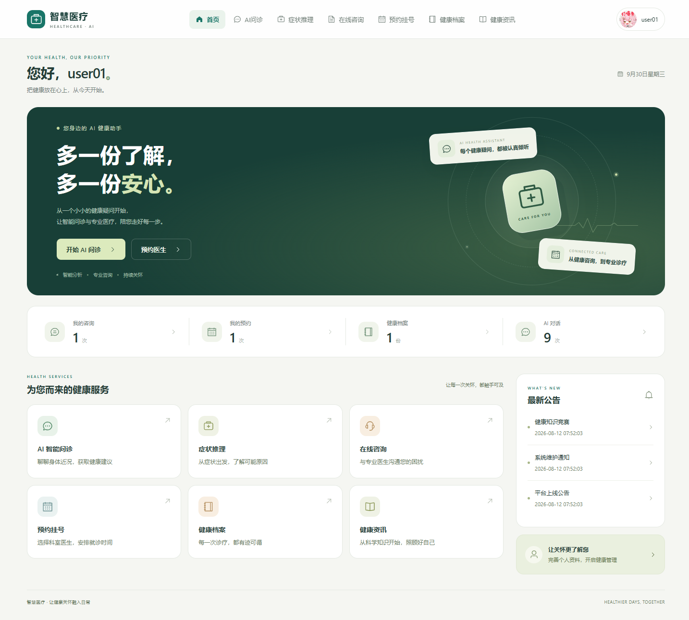
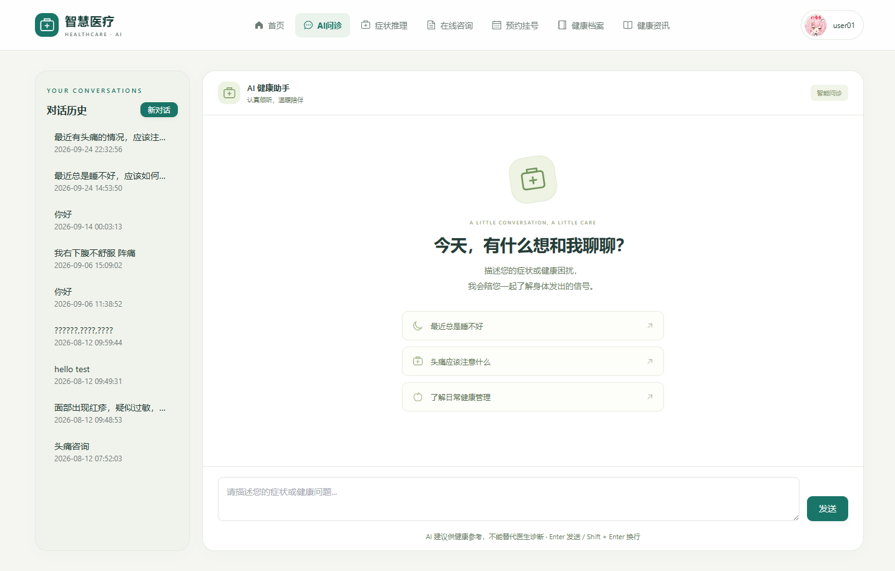
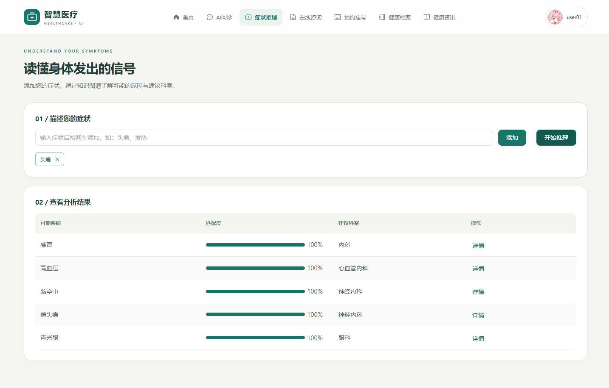
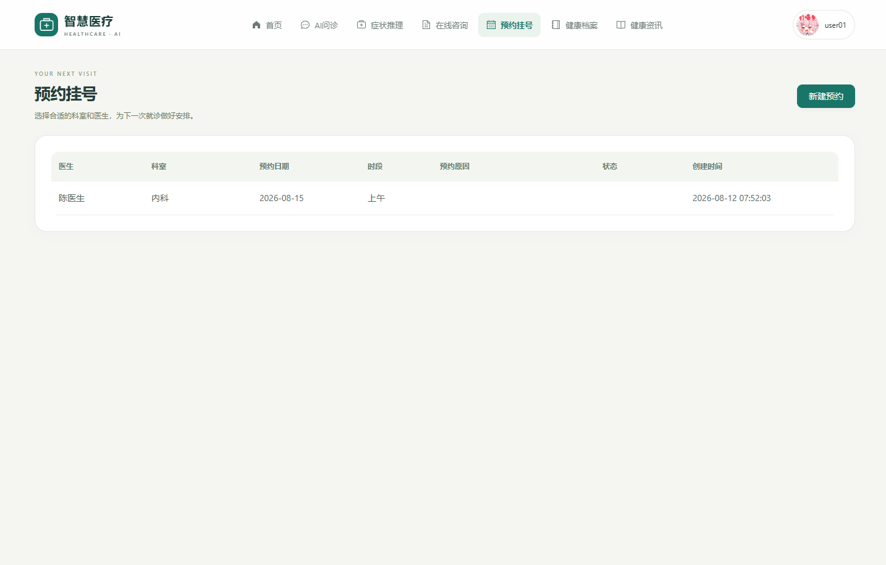

<p align="center">
  
</p>

# AI 智能医疗问诊平台

**智慧医疗**将 AI 问诊、症状推理、在线咨询与预约挂号放在同一个平台中，配套健康档案、科普资讯和医生、管理员工作台。基于 **Vue 3 + FastAPI**，使用 **RAG、Neo4j 与 ChromaDB** 为健康问答提供参考上下文，支持桌面与手机浏览器。

[界面预览](#界面预览) · [核心能力](#核心能力) · [工作原理](#工作原理) · [快速开始](#快速开始) · [开发与验证](#开发与验证)

> 本项目用于学习与教学演示。AI 回答及症状匹配结果仅供参考，不能替代专业医生的诊断。

## 界面预览

**一个入口，连接日常健康服务。** 患者首页集中呈现 AI 问诊、症状推理、在线咨询、预约挂号、健康档案与健康资讯。



<details>
<summary><strong>展开查看 AI 问诊、症状推理与预约挂号</strong></summary>

### AI 问诊

支持连续对话、流式回复与历史会话查看；检索到的知识来源随回答返回。



### 症状推理

输入症状后查看相关疾病与建议科室。页面中的匹配度反映症状匹配比例，不代表患病概率。



### 预约挂号

选择科室与医生，安排就诊时间，并查看预约状态。



</details>

截图来自项目现有界面；[查看完整截图目录](./docs/screenshots/2026-09-30/)。

## 核心能力

- **有检索上下文的 AI 问诊** — 检索知识文档，结合症状图谱匹配结果生成回答，通过 SSE 流式输出，并返回参考来源。
- **可维护的医疗知识** — Markdown、PDF、Word 与 TXT 文档可解析、分块并向量化；Neo4j 存储疾病、症状、科室、药物、检查与饮食关系。
- **三种角色的业务协作** — 患者发起咨询与预约，医生处理咨询和就诊安排，管理员维护业务数据与知识内容。
- **桌面与手机共用一套系统** — 响应式导航与表格卡片适配，保留移动端的查看、编辑、回复等操作。

| 角色 | 可用功能 |
| --- | --- |
| 患者 | 注册与登录、AI 问诊与历史会话、症状推理与疾病详情、在线咨询、预约挂号、健康档案、健康资讯与公告 |
| 医生 | 工作台、咨询回复、预约确认 / 完成 / 取消、患者档案维护 |
| 管理员 | 数据统计、用户 / 医生 / 科室管理、知识文件管理、知识图谱搜索与可视化、咨询 / 预约 / 文章 / 公告管理 |

三种角色均支持个人资料、头像与密码维护，通过 JWT 鉴权和前端路由守卫区分访问权限。

## 工作原理

一次 AI 问诊由以下步骤组成，具体实现见 [RAG 服务](./server/services/rag_service.py)：

1. **检索文档**：将健康问题用于 ChromaDB 向量检索，获取相关知识片段。
2. **匹配图谱**：从问题中匹配症状关键词，在 Neo4j 中查找相关疾病与建议科室；未命中关键词时跳过此步骤。
3. **组织上下文**：合并知识片段、图谱结果与最近的对话记录，交给对话模型。
4. **返回回答**：通过 SSE 输出文本，结束时返回参考来源与图谱结果。

| 层次 | 技术与职责 |
| --- | --- |
| 前端 | Vue 3 · Vue Router · Pinia · Element Plus · ECharts · Axios · Markdown-it · Vite |
| 后端 | FastAPI · SQLAlchemy · PyMySQL · python-jose；统一响应与中文校验提示 |
| 业务数据 | MySQL：账号、咨询、预约、档案等业务记录 |
| 知识检索 | ChromaDB：文档向量；Neo4j：医疗知识关系 |
| AI 服务 | LangChain · LangChain-OpenAI；默认使用 DeepSeek 对话模型与阿里云 DashScope Embedding |

## 快速开始

以下命令以 **Windows PowerShell** 为例，从项目根目录执行。

### 1. 准备环境与配置

| 依赖 | 要求 |
| --- | --- |
| Python | 3.11+ |
| Node.js | 20.19+（20.x）或 22.12+；与当前 Vite 8 的引擎要求一致 |
| MySQL | 5.7+ / 8.x |
| Neo4j | 5.x，社区版即可 |

先启动 MySQL 与 Neo4j。首次克隆后，从项目根目录复制[配置示例](./server/core/config.example.py)，再按本机环境修改生成的 `server/core/config.py`：

```powershell
Copy-Item server/core/config.example.py server/core/config.py
```

本地配置文件已加入 Git 忽略规则；已有配置时无需重复复制。

| 配置项 | 用途 |
| --- | --- |
| `MYSQL_*` / `DATABASE_URL` | MySQL 连接，业务数据库为 `db_ai_medical` |
| `NEO4J_URI` / `NEO4J_USER` / `NEO4J_PASSWORD` | 知识图谱连接 |
| `LLM_API_KEY` / `LLM_BASE_URL` / `LLM_MODEL` | 对话模型凭据、接口地址与模型名 |
| `EMBEDDING_API_KEY` / `EMBEDDING_BASE_URL` / `EMBEDDING_MODEL` | 文档向量化与问题检索使用的模型配置 |
| `UPLOAD_DIR` / `CHROMA_PERSIST_DIR` | 上传文件与向量库目录；上传目录默认是 `F:/uploads33`，需按本机调整 |

缺少有效的模型配置时，AI 问诊或知识库向量化不可用。配置方式以当前 Python 配置文件为准。

**首次部署的数据准备：** [SQL 导入脚本](./server/scripts/import_sql.py) 依赖 `server/sql/db_ai_medical.sql`，但当前项目目录未包含该文件。需先补齐初始化 SQL，或准备好已有的业务数据库；导入脚本中的连接信息单独配置，需与实际 MySQL 服务一致。

### 2. 安装后端依赖与初始化数据

```powershell
cd server
python -m venv venv
.\venv\Scripts\python.exe -m pip install -r requirements.txt

# 仅在已补齐 SQL 文件并核对脚本连接信息后执行
.\venv\Scripts\python.exe scripts\import_sql.py

# 业务数据库就绪后，初始化图谱与示例文档
.\venv\Scripts\python.exe scripts\init_graph.py
.\venv\Scripts\python.exe scripts\init_knowledge.py
```

若使用已初始化的数据库，可跳过对应初始化步骤。示例知识文档位于 [server/docs_seed](./server/docs_seed/)，包含高血压、感冒与流感、糖尿病健康管理内容。

### 3. 启动后端与前端

在 `server` 目录启动后端：

```powershell
.\venv\Scripts\python.exe -m uvicorn main:app --host 127.0.0.1 --port 8000
```

新开一个终端，从项目根目录启动前端：

```powershell
cd client
npm install
npm run dev
```

打开 [http://localhost:5173](http://localhost:5173) 进入系统；后端接口文档位于 [http://127.0.0.1:8000/docs](http://127.0.0.1:8000/docs)。患者可从登录页注册账号，再进入 AI 问诊页面开始对话。

手机与电脑处于同一局域网时，可访问 Vite 启动日志中的 `Network` 地址。前端已配置 `/api` 与 `/uploads33` 到本机后端的代理。

## 开发与验证

```powershell
cd client
npm test                          # 组件行为测试
npm run build                     # 前端构建
npx playwright install chromium
npm run test:e2e                   # 浏览器回归测试
```

浏览器测试拦截 `/api/v1` 并使用模拟数据，不代表真实数据库、Neo4j、模型服务与文件存储已完成联调。既有移动端检查范围与结果见 [移动 Web 验证记录](./docs/mobile-web-verification.md)。

<details>
<summary><strong>目录导航</strong></summary>

```text
hos/
├── assets/readme/       # README 视觉素材
├── client/
│   ├── src/             # 页面、布局、组件、路由、状态与样式
│   └── tests/           # 组件与 Playwright 测试
├── server/
│   ├── api/v1/          # 业务接口
│   ├── core/            # 配置、鉴权与依赖
│   ├── db/              # 数据库引擎与会话
│   ├── models/          # 业务数据模型
│   ├── rag/             # 文档解析、分块、Embedding 与向量存储
│   ├── services/        # RAG、图谱与业务服务
│   ├── scripts/         # 数据初始化与迁移脚本
│   ├── docs_seed/       # 示例知识文档
│   └── main.py          # FastAPI 入口
└── docs/                # 截图、设计与验证记录
```

</details>

<details>
<summary><strong>API 模块索引</strong></summary>

统一前缀为 `/api/v1`，完整参数与响应结构以运行后的 Swagger 文档为准。

| 模块 | 路径 |
| --- | --- |
| 认证与个人中心 | `/auth` · `/profile` |
| 用户、医生与科室 | `/users` · `/doctors` · `/departments` |
| 知识库、AI 问诊与图谱 | `/knowledge` · `/chat` · `/graph` |
| 在线咨询、预约与档案 | `/consult` · `/appointments` · `/records` |
| 资讯、公告与统计 | `/articles` · `/notices` · `/stat` |

</details>

## 使用边界

本项目面向学习与教学演示，AI 输出不构成诊疗意见，症状匹配也不是医学诊断。如有不适，请及时前往正规医疗机构就诊。

[开始本地运行 ↑](#快速开始)
